# Dashboard information architecture & vocabulary

Single reference for **support**, **product**, and **engineering** when adding routes or writing user-facing copy.

## Primary navigation (five-tab core)

| Tab (label) | Path | Purpose |
|-------------|------|---------|
| **Picks** | `/dashboard` | **Picks cluster** (#766): Make Picks / Picks Lab / Scorecard. Primary tab stays active on all three. Global date picker stays on. |
| **Pools** | `/dashboard/pools` | Pools **cluster**: My Pools, Create Pool, Join Pool (sub-nav). |
| **Standings** | `/dashboard/standings` | **Show standings** for the selected show (everyone or one pool). Tertiary: Show / Tour / Year / Pools. |
| **Stats** | `/dashboard/stats` | **Stats cluster** (#769): Personal / Global / Band. Primary tab stays active on all three, on `/dashboard/stats/night` (crowd deep dive, not a chip), and on the `/dashboard/tour-stats` redirect hop. |
| **Account** | `/dashboard/profile` | Account **cluster** (#770): identity, **Messages**, **Preferences** (sub-nav). Path prefix stays `/dashboard/profile/*`. |

**Admin** (sixth item, single admin user): `/dashboard/admin` — War Room. Bottom nav is **5 columns** for players, **6** when Admin is present.

### Stats cluster (#769 chrome / #1004 content)

Nested routes (not `?view=`). Icon: `BarChart3`. Personal, Global, and Band use the chrome tour scope picker (`?tour=`). Personal’s **All-time** block is tour-agnostic; the picker restamps only **This tour**. **Crowd night** (`/dashboard/stats/night`, #694) is show-scoped: the date picker shows, the tour picker hides, and it is not a fourth tray chip. Standings crowd pulse links to it.

| Sub-nav | Path | Responsibility |
|---------|------|----------------|
| **Personal Stats** | `/dashboard/stats` and `/dashboard/stats/personal` | Every *your* stat. **All-time \| This tour** tray (All-time default). All-time inner tray: **Your stats \| Top picks**. This tour is the “Your picks this tour” self overlay (no inner tray). Profile may keep a quiet **View personal stats** link. |
| **Global Stats** | `/dashboard/stats/global` | Leaderboards of those same individual stats (best → worst). **v1.77.0:** **All-time \| This tour** tray, then **PPS \| Picking Avg \| SLG**. **v1.100.0 (#1044):** **Vintage** and **Bustout** on the same tray. Vintage is the mean debut year of the different songs picked; an older year ranks higher and needs 3 shows. Bustout is the count of slots whose Bustout Boost fired; a count of 0 is not ranked. SLG is total points ÷ (shows × 30); a show of in-setlist hits is 1.000. All-time SLG needs 15 shows; other ratio boards (and tour SLG) need 3. Top 50 paginated (10/page) + you-row (pinned when off-page). No song explorer. No self overlay. In most played and pool-scoped boards stay out. |
| **Band Stats** | `/dashboard/stats/band` | Band/song datasets now: #555 `TourStatsView` frequency / bustouts / high gaps. `#300` adds more bands later — it does not gate this slot. |
| **Crowd night** | `/dashboard/stats/night` | Show-scoped crowd deep dive (#694). Not a tertiary chip. Date picker, not the tour picker. Aggregates only — no night setlist. |

**Legacy redirect:** `/dashboard/tour-stats` → `/dashboard/stats/band` (preserve `?tour=`). Stats primary stays active on the hop.

**Public marketing counterpart (#665):** `/tour-stats` and `/tour-stats/:tourSlug` — Band’s public twin: aggregate song datasets only (most played, bustouts, gaps); default tour is the **current** tour (newest `lastShowDate` on `_index`). Not a dashboard route; `robots.txt` still Disallows `/dashboard/*`. Do not unlock private Stats or self-overlay for anonymous users.

### Feature discovery “New” markers (#639)

Soft **New** labels (not coachmarks) may appear temporarily on:

- Stats chrome **Band** segment → clears after visiting `/dashboard/stats/band` (compact corner **dot**, not a “New” text label — keeps the Band Stats word readable). Same `tour-stats` feature id as the retired Standings Stats pill.
- Official setlist card on Standings → clears when the card is toggled open/closed
- Profile **Avatar** / **Badges** headings → clears after picking an avatar
- **Did you know?** under the Standings self-recap (and the same note on Scorecard, and on the phone Make Picks recap) → picking average, points per show, and slugging on Personal and Global. Dismisses on the X. Expires **2026-12-31** (`stats-rates`).

Markers auto-expire by catalog `until` date and persist dismissals in `localStorage` per signed-in uid. Support can tell users: clear site data for the origin if a marker is stuck; otherwise ignore — they vanish by end of the window.

### Picks tertiary (#766)

Nested routes (not `?view=`). Primary **Picks** tab stays active. Lab segment is **always visible**; when `VITE_ENABLE_PREDICTION_LAB` is not `true`, Picks Lab shows an empty / coming-soon shell (do not hide the tab).

| Sub-nav | Path | Responsibility |
|---------|------|----------------|
| **Make Picks** | `/dashboard` and `/dashboard/picks` | Existing picks form (lock/edit). `utm_campaign` landed logging stays here. **Crowd helper (#694 P2):** tour chalk before showtime (earlier locked nights only; Use fills an open slot and does not save). Live consensus, slot favorites, and highest gaps after lock. Full crowd stats links to `/dashboard/stats/night`. Not a new tertiary chip. |
| **Picks Lab** | `/dashboard/picks/lab` | Prediction Lab (`PickPredictionPanel`) when the env flag is `true`; otherwise coming-soon. Live **Your card** mirrors the shared draft. **Use** does not persist — Lock In / Update Picks still saves. |
| **Scorecard** | `/dashboard/picks/scorecard` | Show-scoped self card (#767). Everyone by default. `?pool=` compares with one of your pools (#1043). Not a new tab. |
| **Rewind** | `/dashboard/rewind` | Weekly historical show (#1142). Segment is **hidden** unless `VITE_ENABLE_REWIND_MODE=true`. Direct URL shows a closed shell when the flag is off. Date picker hides. Scores are not live standings. |
| **Phish IQ** | `/dashboard/phish-iq` | Daily five-question quiz (#1143). Segment stays visible. Date picker hides. Streak saves on the signed-in user. The public play URL is `/phish-iq`. |

**Scorecard (#767, audience and crowd % #1043):** Show comes from the existing global date picker. Default audience is everyone. When you are in at least one pool, the card has a **Compare** control (Everyone, then each pool). `?pool=<id>` on this route remembers that pool. An unknown id falls back to everyone. Rank, overlap, and crowd % use the same membership filter as Standings (`filterPicksToAudience`, including join-day rules). No new tab, route, or collection. If that night does not count for the pool, the card says so and does not invent a pool rank.

Overlap (“N players also picked this”) is **post-lock only** (LIVE / PAST or admin-locked NEXT). Pre-lock shows the player’s own card — no overlap. **Pre-lock overlap stays deferred:** counts beside the player’s songs while picks are still open would show how the room is leaning before showtime. That stays behind the crowd-pulse disclosure gate.

Crowd % replaces model odds on this card. After showtime (`LIVE` / `PAST`), each filled slot shows **Crowd** and the share of locked cards in the selected audience that include that song. The number comes from the same night aggregate as Standings and Make Picks (`aggregateCrowdNightSongs`). It is not Storage `playProb`. It stays off before showtime, including an admin lock that is still `NEXT`. **Hide crowd pulse** hides Crowd and the overlap line. Rank and graded hits stay. Make Picks and Picks Lab still use `playProb` (#1013). Score / rank reuse the show-scoped standings query — no unbounded picks scan.

Mobile: tertiary tray portals under the context bar via `ChromeSegmentedControl` (same primitive as Profile). Desktop: in-page tray at the cluster layout call site. Make Picks keeps scoring / lock-status tools (`PicksMobileFixedChrome`) on that destination only.

### Account cluster (#418 / #770)

Primary nav **label** is **Account**. Path prefix stays `/dashboard/profile/*` (no `/dashboard/account` family).

| Sub-nav | Path | Responsibility |
|---------|------|----------------|
| **Profile** | `/dashboard/profile` | Handle, favorite song, avatar, badges. Appearance helper is an **InfoTooltip**. Prominent **View public profile** CTA. Quiet **View personal stats** link. |
| **Messages** | `/dashboard/profile/notifications` | Inbox only — Unopened / Read / Archived; archive + delete. No prefs accordion. |
| **Preferences** | `/dashboard/profile/account` | Sign-in, logout, legal, install/PWA, notification prefs (per-channel `notificationPrefs.push`, `.inApp`, and `.email`, #1045), and Hide crowd pulse (`users.gamePrefs.hideCrowdPulse`, #694). That switch also hides Scorecard crowd % and overlap (#1043). Delete account is a text-link disclosure. Contact us is `mailto:support@setlistpickem.com` (inbound allowlist). |

Legacy redirects (preserve bookmarks + email deep links; query string preserved):

- `/dashboard/notifications` → `/dashboard/profile/notifications` (e.g. `?openPush=1` then hops to Preferences)
- `/dashboard/account-security` → `/dashboard/profile/account`

`?openPush=1` and `DashboardInstallEngageBanner` land on **Preferences** (`/dashboard/profile/account?openPush=1`). Avatar in the mobile brand bar links to **Preferences**. Bell links to **Messages**.

### Pools parent / child (active state)

- **Pools** tab stays active on `/dashboard/pools`, `/dashboard/pools/create`, `/dashboard/pools/join`, **and** `/dashboard/pool/:poolId` (**pool details**).
- **Account** tab stays active on the entire Account cluster (including legacy redirect paths).
- **Standings** tab stays active on `/dashboard/standings` only (Show / Tour / Year / Pools).
- **Stats** tab stays active on `/dashboard/stats`, `/dashboard/stats/personal`, `/dashboard/stats/global`, `/dashboard/stats/band`, **and** `/dashboard/tour-stats` (redirect hop).
- **Picks** tab stays active on `/dashboard`, `/dashboard/picks`, `/dashboard/picks/lab`, and `/dashboard/picks/scorecard`.

## Tertiary chrome contract (#765)

Single visual/interaction pattern for in-tab section navigation. **Canonical primitive:** `ChromeSegmentedControl` (`src/shared/ui/ChromeSegmentedControl.jsx`) — NavLink mode (route clusters) or `tablist` / button mode (`value` / `onChange` view switches). **Do not fork tray CSS** in features.

This documents the shared tray contract. Picks (#766), Pools (#768), Stats (#769), and Account (#770) use it.

### Helper copy

Page and section **descriptions default to an `InfoTooltip`** (`DashboardActionRow` `hint`, or a standalone `InfoTooltip` next to a heading/control). Do **not** add a visible description paragraph unless the repo owner explicitly asks — then use `DashboardActionRow` `summary` (or in-flow copy) for that exception. Control-adjacent status lines (e.g. “Sign-in · Google”) are not descriptions.

### Visual

- Rectangular **equal-width** tray (`flex w-full`, segments `flex-1`) — not auto-width pills
- Uppercase labels (`uppercase tracking-widest`)
- Active ring/fill (`tone="chrome"`, default): `bg-brand-primary/15 text-brand-primary ring-1 ring-inset ring-brand-primary/35`
- In-page filters (`tone="inset"`, Stats All-time / boards trays): same equal-width layout, recessed field, neutral selected chip — do not fork tray CSS in features. Helper `InfoTooltip`s use a **reserved trailing column** beside the tray (empty spacer when no hint) so stacked quaternary trays keep one width. On Personal / Global, both quaternary rows **stick with the Stats chrome** (desktop sticky stack portal below tertiary; mobile fixed chrome below the Personal/Global/Band tray) so boards/cards scroll underneath.
- Inactive: `text-content-secondary` + inset hover
- Icons optional (Standings today; Profile text-only) — do not require icons on every cluster

### Placement

| Viewport | Pattern |
|----------|---------|
| **Mobile (`mob`)** | Fixed under the context bar via `useDashboardMobileChromePortal` (`ProfileMobileFixedChrome`, `StandingsMobileFixedChrome`). Phone landscape is mobile. |
| **Desktop (`desk`)** | One sticky stack in `#dashboard-scrollport`: optional Tour Date / Tour scope / Year scope, then cluster title + full-width tertiary tray (`DashboardStickyPageChrome` portaled into `DashboardStickyChromeStack`). Optional utilities sit on the **title row** as icon buttons (`ChromeIconButton` — Scale for Scoring rules on Picks/Standings, BookOpen for How pools work), never labeled pills beside the tray — trays stay equal width across clusters. Stats Personal / Global also portal quaternary inset trays into the same sticky stack (below tertiary). Lock / install banners and page body scroll underneath. Pool details stays Option C (no cluster title). War Room keeps the layout H2. |

Visibility (`hidden desk:block` vs portal) lives at the **cluster layout call site**, not inside `ChromeSegmentedControl`.

### Behavior

1. **Primary tab stays active** on all child routes/views (mirror Pools → pool details and Profile cluster `isActive` in `DashboardLayout`).
2. **Snap-to-top** on tertiary change (`scrollAppToTop`) — already inside `ChromeSegmentedControl`.
3. `aria-label` on the tray; NavLink clusters use `<nav>`; view switches use `role="tablist"` + `role="tab"` / `aria-selected`.

### Landscape / `desk` and `mob` screens (#705, part of #704)

`md:` is **width reflow** only (type size, wrapping, column padding). It is not a device switch. Do **not** add new `md:hidden` / `hidden md:*` chrome gates.

Device chrome uses raw screens in `tailwind.config.js`:

| Screen | Query | What it means |
|--------|--------|----------------|
| `desk` | `(min-width: 768px) and (min-height: 480px)` | Sidebar, sticky stack, desktop headings. iPad portrait (768×1024) and desktop stay here. |
| `mob` | `(max-width: 767.98px), (max-height: 479.98px)` | Exact complement of `desk`. Portrait phones and phone landscape (wide, under 480px tall) stay here. |
| `short` | `(max-height: 479.98px)` | Landscape compaction only. Does not overlap `desk`. |

Write chrome pairs as `hidden desk:*` (desktop tree) and `desk:hidden` (mobile tree) so exactly one tree is visible. `mob:` is the mobile-side screen when a rule must be authored from that side. Tour Date, Tour, and Year each mount once in the sticky stack and portal into `#dashboard-mobile-scope-slot` below `desk` (#707). Standings Show / Tour / Year / Pools is one `StandingsChrome` mount, so one tablist is in the DOM per viewport. The scrollport top padding is `mob:pt-[calc(env(safe-area-inset-top)+var(--dashboard-mobile-chrome-h))]`. The shell sets that variable from the route’s chrome reservation. Marketing nav stays on its own breakpoints (#706).

Under `short`, `DashboardMobileBrandBar` is hidden and `--dashboard-mobile-chrome-h` drops by 4rem (the brand row: `h-12` + `py-2`). The context bar still scroll-hides through `useScrollDirection`. The static dashboard boot shell uses the same `desk` query and hides `.dbs-brand-bar` under `short`.

### Checklist: adding a cluster

When you add or rename a tertiary cluster (or a `/dashboard/*` child):

1. Update **`getDashboardPageMeta`** (`contextTitle`, `showDatePicker`, `showTourScopePicker`, `showYearScopePicker`, `layoutDesktopHeading`, `ownsDesktopStickyChrome`, `layoutDetailEyebrow` if needed).
2. Update **`isDashboardNavItemActive`** in `src/app/layout/model/dashboardNav.js` so the primary tab stays active on every child (mirror **Pools / pool details** and **Account / Preferences**). The sidebar and the bottom tabs both render `DashboardNavItem`.
3. Add a row to **`scripts/verify-dashboard-meta.mjs`** and run **`npm run verify:dashboard-meta`**.
4. Update **`src/shared/config/dashboardVocabulary.js`** (`NAV_LABEL_*`) and this doc.
5. If paths change: **`src/shared/config/dashboardRoutes.js`** (cluster constants + legacy redirects) and **`docs/API.md`** when a declared route is added/renamed.
6. Compose **`ChromeSegmentedControl`** — mobile portal chrome + desktop sticky/in-page tray. Gate those trees with `desk:` / `desk:hidden`, not `md:hidden`. No per-feature tray class strings.
7. Run **`npm run verify:dashboard-ui`**.

### Current tertiary clusters

| Primary (stays active) | Tertiary segments | Notes |
|------------------------|-------------------|--------|
| **Pools** | My Pools · Create Pool · Join Pool | Nested routes; pool details stays a child, not a segment |
| **Picks** | Make Picks · Picks Lab · Scorecard | Nested routes (#766). Lab segment always visible; Scorecard is the #767 surface. |
| **Account** | Profile · Messages · Preferences | Nested routes under `/dashboard/profile/*` (#770). |
| **Standings** | Show · Tour · Year · Pools | Stats moved to the Stats primary (#769). Year is the global calendar-year board (#1110). |
| **Stats** | Personal · Global · Band | Nested routes (#769 / #1004). Tray drops the redundant “Stats” suffix so three uppercase chips fit. Global is leaderboards; Band is the song explorer. Crowd night is a linked route, not a fourth chip. |

`NAV_LABEL_STATS` is the **Stats** primary. `NAV_LABEL_ACCOUNT` is the **Account** primary; `NAV_LABEL_PROFILE` is identity tertiary only; `NAV_LABEL_PREFERENCES` is the Preferences tertiary (`/dashboard/profile/account`).

### Pools tertiary (#768)

| Sub-nav | Path | Responsibility |
|---------|------|----------------|
| **My Pools** | `/dashboard/pools` | `UserPoolsSection` list (default) |
| **Create Pool** | `/dashboard/pools/create` | Create flow (`PoolCreateCard` / `useUserPools` `handleCreate`) |
| **Join Pool** | `/dashboard/pools/join` | Join-by-code; pending-join / invite retry (`POOL_INVITE_STORAGE_KEY`) |
| **Pool details** | `/dashboard/pool/:id` | Unchanged Option C chrome; Pools primary stays active (not a tertiary segment) |

Nested routes (not `?view=`). After a successful create or join, navigate to that pool’s details. How-it-works is a **BookOpen** icon in the mobile context-bar trailing slot and on the desktop **title row** (guide affordance; Standings/Picks Scale pattern) — not a fourth tertiary segment, not beside the tray, and not an in-flow disclosure. Post-auth `/join/:code` with a pending invite lands on **Join Pool**.

## Pool details desktop chrome (decision: Option C)

**Player-facing name:** **Pool details** (internal code may still say “Pool Hub”).

| Layer | What users see |
|--------|----------------|
| Mobile context bar | **Pool Details** |
| Desktop shell | Eyebrow **POOL DETAILS** (same typographic tier as in-page section labels, e.g. Game Status) |
| Under Back | Breadcrumb **Pools · {pool name}** (`Pools` links to list) |
| In-page hero | Pool **name** as `<h1>` + members line (unchanged) |

Rationale: **Entity-first** detail view without a second full-width display title duplicating the pool name; wayfinding ties back to **Pools**.

## Vocabulary (`src/shared/config/dashboardVocabulary.js`)

| Term | Meaning |
|------|---------|
| **Picks** | Tab + context + desktop H1 for the Picks cluster (`NAV_LABEL_PICKS`) — `/dashboard`, `/dashboard/picks`, `/dashboard/picks/lab`, `/dashboard/picks/scorecard`. |
| **Make Picks** | Picks-cluster tertiary for the form (`NAV_LABEL_MAKE_PICKS`). |
| **Picks Lab** | Picks-cluster tertiary for Prediction Lab (`NAV_LABEL_PICKS_LAB`); path `/dashboard/picks/lab`. |
| **Scorecard** | Picks-cluster tertiary (`NAV_LABEL_SCORECARD`); path `/dashboard/picks/scorecard`. Show-scoped self card. Everyone, or one pool via `?pool=` (#767 / #1043). |
| **Pools** | Tab + context + desktop H1 for `/dashboard/pools`, `/dashboard/pools/create`, and `/dashboard/pools/join` (`NAV_LABEL_POOLS`) — same word in nav and shell. Tertiary labels: **My Pools** / **Create Pool** / **Join Pool**. |
| **Account** | Primary tab + identity context for the `/dashboard/profile/*` cluster (`NAV_LABEL_ACCOUNT`). Path prefix unchanged. |
| **Profile** | Identity tertiary only (`NAV_LABEL_PROFILE`); handle / favorite song / avatar / badges. |
| **Messages** | Account-cluster inbox (`NAV_LABEL_MESSAGES`); path `/dashboard/profile/notifications`. Prefs live on Preferences. |
| **Preferences** | Account-cluster settings (`NAV_LABEL_PREFERENCES`); path `/dashboard/profile/account`. |
| **Admin** | Tab label for `/dashboard/admin` (`NAV_LABEL_ADMIN`); context + desktop H1 stay **War Room** (meta string in `dashboardPageMeta.js`). |
| **Standings** | Tab, context bar for `/dashboard/standings` (`NAV_LABEL_STANDINGS`). Desktop **Standings** title + Show/Tour/Year/Pools tray live in the shared sticky stack (not the layout H2). Lock / install banners sit in the scrolling body below that stack. View is URL-synced via `?view=show\|tour\|year\|pools`. Pools view takes an optional `?pool=<id>` sub-selector. `?view=tour` hides the global date picker and shows the shared tour scope picker (`?tour=`). `?view=year` hides the date picker and shows the year picker (`?year=YYYY`, omitted when the year is the newest selectable year). |
| **Stats** | Primary tab + context + desktop H1 for the Stats cluster (`NAV_LABEL_STATS`) — `/dashboard/stats`, `/dashboard/stats/personal`, `/dashboard/stats/global`, `/dashboard/stats/band`, `/dashboard/stats/night`. Tertiary chips: **Personal** / **Global** / **Band**. Crowd night is not a chip. |
| **Personal** | Stats-cluster tertiary for career self stats (`NAV_LABEL_PERSONAL_STATS`). Destination name: Personal Stats. |
| **Global** | Stats-cluster tertiary for the private tour explorer (`NAV_LABEL_GLOBAL_STATS`); path `/dashboard/stats/global`. Destination name: Global Stats. |
| **Band** | Stats-cluster tertiary shell (`NAV_LABEL_BAND_STATS`); path `/dashboard/stats/band`. Destination name: Band Stats. |
| **Show standings** | Ordered points for **one show date** only (Standings screen); use this phrase in glossary, help, and cross-links where the “one night” nuance matters. When points match, more exact slots rank higher, then more correct picks, then handle. A single show skips nightly wins (`SHOW_STANDINGS_DESCRIPTION`, #1218 / #1219). |
| **All-time standings** | Cumulative points / wins / shows across **every** finalized show (all tours). Canonical name on pool details (`POOL_ALL_TIME_STANDINGS_HEADING`) and optional global companion on Standings. Replaces legacy **Season totals**. See #148. |
| **Tour standings** | Cumulative points / wins / shows scoped to the **current tour** via `show_calendar.showDatesByTour` (`TOUR_STANDINGS_HEADING`). Global on Standings (#219 / #1218): official rank is points, then exact slots, then correct picks, then nightly wins, then handle. A tie shares a rank only when that cascade does not separate the rows. Pool-scoped tour standings on pool details (#148) still number rows in list order. |
| **Year standings** | Cumulative points / wins / shows for one **calendar year** of show dates (`YEAR_STANDINGS_HEADING`, #1110). A Dec 31 show counts for that year even when the music runs past midnight. A Jan 1 show counts for the next year. The board is everyone with at least one graded show that year, using the same points, nightly-win, and shows-played rules as tour standings (`aggregateTourStandings`). Rank uses the same cascade as tour standings. A tie shares a rank only when that cascade does not separate the rows. The view is available whenever Standings opens — it does not wait for a morning email. A finished year shows its board as soon as that last show is graded. Empty year copy when nothing is graded yet. Global only; a pool-scoped year view is later. All-time standings stay the career board. When the live calendar’s last show of the year that just closed is graded, that year view plays a year-end celebration once per person in this browser (#1112): fireworks that do not block the board, a skip control, and Annual Winner, Runner-up, and Third Place while it plays. It does not play on Show, Tour, Pools, an earlier year, the bundled fallback calendar, or after two calendar months from that finale date. |
| **Season totals** | Legacy alias of **All-time standings** on pool details; retained as a `@deprecated` re-export while the pool-side migration (#148) lands. Avoid in new copy. |
| **Tonight's winner / top score** | Standings banner for everyone at the top score (#218). One player: **Tonight's winner**. More than one: **Tonight's top score**, plus a line that each of them gets a nightly win while the board ranks that tie by exact slots, then correct picks, then handle (#1219). On **Pools**, computed from pool-filtered picks (same audience as the leaderboard). |
| **Last show's winner / top score** | Standings callout for the **prior tour night** while the selected show is **NEXT** (picks still open) (#218, #305). Hidden once picks lock (**LIVE**). **Show tab:** global prior-night picks; **Pools tab:** pool-filtered prior night (same rules as tonight for that audience). Heading uses `lastShowWinnerHeading(winnerCount, poolName?)` — one player is **Last show's winner**, more than one is **Last show's top score** with the same nightly-win note. On Pools, suffix **`· {pool name}`** when known. |
| **View results** (Standings) | **Show tab only:** `DashboardRowPill` on the last-show winner banner jumps to `/dashboard/standings?showDate=<prior night>`; `DashboardLayout` syncs the global date picker (layout `setSelectedDate` + URL so repeat clicks work). **Pools:** banner may still show; **no** View results link (product lock #305). Implementation: `StandingsWinnerOfTheNightBanner`, `useStandingsScreen`, `StandingsPage` / `onSelectShowDate`. |
| **Wins** | For any scope (one show, a tour, a calendar year, all-time), the count of shows where a player ties/beats the global high score across every graded non-empty pick (`max === 0 → skip`). Same rule on Profile, Standings, Tour standings, Year standings, and pool surfaces; implemented once in `src/shared/utils/showAggregation.js::reduceShowWinners`. |
| **Pool details** | Screen for one pool: roster, invites, game status, archive links, All-time and Tour standings (`NAV_LABEL_POOL_DETAILS`). |

### User-visible string ownership (support / engineering)

| Users see | Route / surface | Source of truth |
|-----------|-----------------|-----------------|
| Picks | `/dashboard`, `/dashboard/picks`, `/dashboard/picks/lab`, `/dashboard/picks/scorecard` | `NAV_LABEL_PICKS` |
| Make Picks | Picks cluster tertiary | `NAV_LABEL_MAKE_PICKS` |
| Picks Lab | `/dashboard/picks/lab` | `NAV_LABEL_PICKS_LAB` |
| Scorecard | `/dashboard/picks/scorecard` | `NAV_LABEL_SCORECARD` |
| Pools | `/dashboard/pools`, `/dashboard/pools/create`, `/dashboard/pools/join` | `NAV_LABEL_POOLS` |
| Pool Details (context) | `/dashboard/pool/:id` | `NAV_LABEL_POOL_DETAILS` |
| Pool details (desktop eyebrow) | Pool hub | `POOL_DETAILS_LAYOUT_EYEBROW` |
| Standings | `/dashboard/standings` | `NAV_LABEL_STANDINGS` |
| Stats | `/dashboard/stats`, `/dashboard/stats/personal`, `/dashboard/stats/global`, `/dashboard/stats/band`, `/dashboard/stats/night` | `NAV_LABEL_STATS` |
| Personal | Stats cluster tertiary | `NAV_LABEL_PERSONAL_STATS` |
| Global | `/dashboard/stats/global` | `NAV_LABEL_GLOBAL_STATS` |
| Band | `/dashboard/stats/band` | `NAV_LABEL_BAND_STATS` |
| Account | `/dashboard/profile` (primary) | `NAV_LABEL_ACCOUNT` |
| Profile | `/dashboard/profile` (identity tertiary) | `NAV_LABEL_PROFILE` |
| Messages | `/dashboard/profile/notifications` | `NAV_LABEL_MESSAGES` |
| Preferences | `/dashboard/profile/account` | `NAV_LABEL_PREFERENCES` |
| War Room | `/dashboard/admin` | `getDashboardPageMeta` (admin branch) |
| Admin (tab only) | `/dashboard/admin` | `NAV_LABEL_ADMIN` in `DashboardLayout.jsx` |

## Scoring rules (single primary surface)

- **Primary:** `ScoringRulesModal` via **`ScoringRulesModalProvider`** in the dashboard shell (`DashboardLayout`).
- **Entry:** “Scoring rules” actions call `useScoringRulesModal().openScoringRules`.
- **Deep link:** `/dashboard/scoring` **redirects** to `/dashboard?scoringRules=1`; query is consumed and stripped when the modal opens.
- **No** standalone scoring content page.

### Runtime contract: `useScoringRulesModal`

- **Only call** `useScoringRulesModal()` from components rendered **under** `ScoringRulesModalProvider` (today: route pages inside `DashboardLayout`).
- Calling it from the splash screen, Storybook stories, or tests **without** wrapping the provider will **throw** by design—wrap with `<ScoringRulesModalProvider>` in those environments, or open the modal via props on a test double.

## Continuous integration

GitHub Actions workflow **`.github/workflows/ci.yml`** runs:

1. `npm ci`
2. `npm run lint`
3. `npm run verify:dashboard-meta`

On **pull requests** (all branches) and on **push** to `main`, `master`, or `staging`. To cover other long-lived branches with push CI, add them under `on.push.branches` in that file.

**Locally:** same checks anytime with `npm run lint && npm run verify:dashboard-meta`.

## Route → meta map (engineering)

Implemented in `src/app/layout/model/dashboardPageMeta.js`. When you add a `/dashboard/*` route, follow the **Checklist: adding a cluster** above (meta + `isActive` + `verify-dashboard-meta` + vocabulary). Same steps apply when the new path is a tertiary child of an existing primary tab.

## IA diagram (high level)

```mermaid
flowchart TB
  subgraph tabs [Bottom / sidebar tabs]
    P[Picks]
    Po[Pools]
    S[Standings]
    St[Stats]
    Pr[Account]
  end

  P --> PicksRoute["/dashboard · Make Picks"]
  P --> PicksAlias["/dashboard/picks · Make Picks"]
  P --> PicksLab["/dashboard/picks/lab · Picks Lab"]
  P --> PicksScore["/dashboard/picks/scorecard · Scorecard"]
  Po --> PoolsList["/dashboard/pools\nMy Pools"]
  Po --> PoolsCreate["/dashboard/pools/create\nCreate Pool"]
  Po --> PoolsJoin["/dashboard/pools/join\nJoin Pool"]
  Po --> PoolDetail["/dashboard/pool/:id\nPool details"]
  S --> StandingsRoute["/dashboard/standings"]
  St --> StatsPersonal["/dashboard/stats · Personal"]
  St --> StatsPersonalAlias["/dashboard/stats/personal · Personal"]
  St --> StatsGlobal["/dashboard/stats/global · Global"]
  St --> StatsBand["/dashboard/stats/band · Band"]
  St --> StatsNight["/dashboard/stats/night · Crowd night"]
  St --> TourStatsRedirect["/dashboard/tour-stats → Band"]
  Pr --> ProfileRoute["/dashboard/profile\nProfile"]
  Pr --> MessagesRoute["/dashboard/profile/notifications\nMessages"]
  Pr --> AccountRoute["/dashboard/profile/account\nPreferences"]

  PicksAlias -.->|same tab active| PicksRoute
  PicksLab -.->|same tab active| PicksRoute
  PicksScore -.->|same tab active| PicksRoute
  PoolDetail -.->|breadcrumb| PoolsList
  MessagesRoute -.->|same tab active| ProfileRoute
  AccountRoute -.->|same tab active| ProfileRoute
  StatsPersonalAlias -.->|same tab active| StatsPersonal
  StatsGlobal -.->|same tab active| StatsPersonal
  StatsBand -.->|same tab active| StatsPersonal
  StatsNight -.->|same tab active, not a chip| StatsPersonal
  TourStatsRedirect -.->|same tab active| StatsPersonal

  subgraph modal [Global modal]
    SR[Scoring rules modal]
  end

  PicksRoute --> SR
  StandingsRoute --> SR
  DeepLink["/dashboard/scoring"] -->|redirect + query| SR
```

## Related code

- `getDashboardPageMeta`, `normalizeDashboardPathname` — `src/app/layout/model/dashboardPageMeta.js`
- `PROFILE_CLUSTER_PATHS`, `isProfileClusterPath`, `PICKS_CLUSTER_PATHS`, `isPicksClusterPath`, `POOLS_CLUSTER_PATHS`, `isPoolsClusterPath`, `STATS_CLUSTER_PATHS`, `isStatsClusterPath` — `src/shared/config/dashboardRoutes.js`
- Tertiary tray — `src/shared/ui/ChromeSegmentedControl.jsx`
- Profile cluster layout — `src/app/layout/ui/ProfileClusterLayout.jsx`
- Picks cluster layout — `src/app/layout/ui/PicksClusterLayout.jsx`
- Pools cluster layout — `src/app/layout/ui/PoolsClusterLayout.jsx`
- Stats cluster layout — `src/app/layout/ui/StatsClusterLayout.jsx`
- Nav items + active rules — `src/app/layout/DashboardLayout.jsx`
- Scoring modal provider — `src/features/scoring/ui/ScoringRulesModalProvider.jsx`

## Related documentation

User journeys and post-auth routing (new vs returning users, invite flows, remembered tab): [USER_ROUTING_AND_JOURNEYS.md](./USER_ROUTING_AND_JOURNEYS.md).
